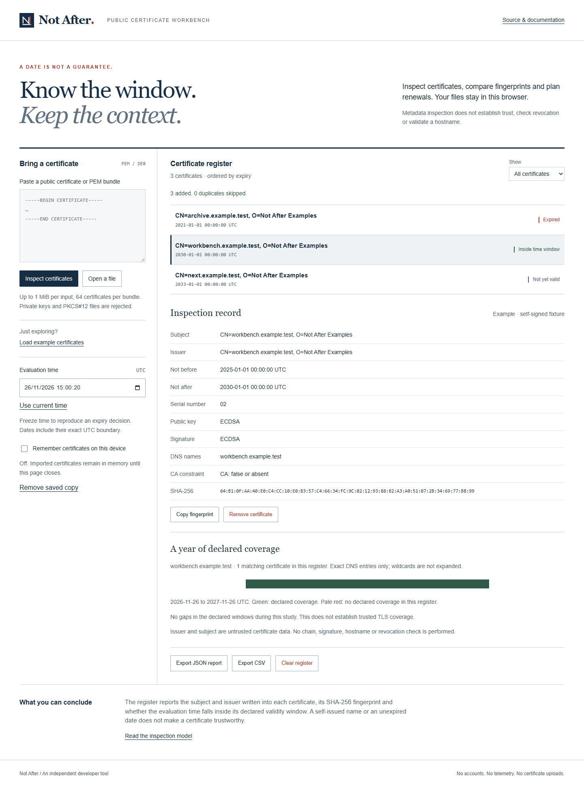

# Not After

[Open the public demonstration](https://italodevjs.github.io/not-after/) · [Verification record](docs/VERIFICATION.md)

A local workbench for public X.509 certificates: inspect a bundle, compare fingerprints, freeze an evaluation time and study the continuity of declared certificate windows.

It answers a small operational question: *which certificates do I have, and where do their declared validity windows leave gaps?* It does not answer whether a certificate should be trusted.



## Run

Requires Node.js 22.12 or newer and npm. No accounts, API keys or database are required.

```sh
npm ci
npm run dev
```

Open the printed localhost URL. Use **Load example certificates** to inspect three self-signed fixtures; they are examples, not public services. To inspect your own material, paste PEM blocks or open public `.pem`, `.crt`, `.cer` or `.der` files. Private keys and PKCS#12 containers are rejected.

```sh
npm test
npm run build
npm run inspect -- --at 2026-11-25T12:00:00Z public/examples/certificates.pem
```

The CLI writes a JSON report to stdout; npm's command banner can be avoided with `npm run --silent inspect -- …`. Errors go to stderr with a nonzero exit code. CLI paths and subjects are included in the output; choose the destination deliberately.

## Implemented behaviour

- Parse PEM bundles and DER public certificates locally using `@peculiar/x509`.
- Deduplicate by SHA-256 of DER bytes, independent of PEM wrapping or filename.
- Evaluate inclusive UTC validity boundaries, with a reproducible evaluation time and a 30-day warning interval.
- Sort the register by expiry; filter expired, future or attention-needed certificates.
- Sweep and merge declared windows for the selected certificate's first exact DNS SAN entry over the following year. Overlapping renewal windows become a single interval; uncovered spans remain visible.
- Export actual JSON and spreadsheet-safe CSV reports for the complete register.
- Optionally remember certificates in this browser. The default is memory only. Saved data is reparsed when restored.

## Boundaries

This is **metadata inspection**, not a TLS validator. It does not verify signatures, certification paths, key usage suitability, revocation, certificate transparency, DNS ownership or hostname matching. A stated issuer name is untrusted input. A green coverage strip only means that declared date intervals overlap; it does not establish service availability or security.

Coverage groups exact DNS SAN strings case-insensitively. It does not expand wildcards, infer common names or perform internationalized hostname equivalence. Missing certificates can produce apparent gaps. The selected date freezes evaluation until you change it; this is not a background renewal monitor.

Inputs are limited to 1 MiB, 64 certificates per PEM bundle, 64 KiB per certificate and 256 unique certificates per register. Browser parsing runs on the main thread within these limits. Large corporate inventories need a different execution model. Persistence uses localStorage, not encrypted storage or multi-device sync. Storage errors are visible; keep a separate copy of your public certificate files.

## Design and implementation

The interface follows an archival register: navy ink, explicit dates and a restrained expiry accent. Its mark is an original ruled monogram. System fonts keep the tool usable without font requests.

- [Architecture and algorithm](docs/ARCHITECTURE.md)
- [Study guide and exercises](docs/STUDY.md)
- [Verification evidence](docs/VERIFICATION.md)
- [Security boundary](SECURITY.md)

The problem originated during a review of an earlier certificate-management experiment. This implementation is new; private repositories, customer records and their histories are not distributed here. AI coding tools assisted implementation, documentation and review. The maintainer needs to understand and validate changes rather than claim exclusively human authorship. There are no adoption or production reliability claims.

MIT licensed. The X.509 library and its dependencies retain their own licenses in the package distribution.
