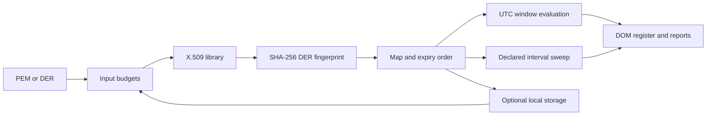

# Inspection model

The browser and CLI use one typed domain model. Browser input flows through byte/PEM budgets, library parsing, SHA-256 derivation, deduplication and a sorted in-memory register. Rendering uses DOM text nodes for certificate-controlled values. Export derives a report from the same records and an explicit evaluation timestamp.

## Identity and ordering

PEM text is an encoding, not an identity. The key is SHA-256 over the DER certificate bytes. `mergeCertificates` builds a Map in O(n + m), preserves the first imported record for a duplicate and then sorts the result in O(k log k) by ISO UTC expiry and fingerprint. All-or-nothing parsing prevents a malformed bundle from leaving an unexplained partial import.

The library decodes ASN.1 and typed SAN/basic-constraint extensions. Hand-writing an ASN.1 parser would add risk without improving the portfolio's actual question. Tests compare its fingerprint and date results against Node's independent `X509Certificate` implementation.

## Time

RFC 5280 describes validity as including both endpoint instants. The implementation reports future when `t < notBefore`, expired when `t > notAfter`, and an in-window warning when the remaining duration is at most 30×24 hours. Remaining days use ceiling for display and are not the basis of classification. Fixed UTC timestamps avoid local daylight-saving changes. The UI explicitly labels its date-time control UTC even if the browser renders a localized calendar.

## Continuity study

For one exact DNS SAN string and a range [a,b], gather matching intervals, clip them to [a,b], discard those outside it and sort by start then end. Merge an interval into the previous interval when its start is at or before the previous end. A cursor walks the merged union to find uncovered interiors. Complexity is O(n log n) time and O(n) additional memory.

The certificate endpoints are inclusive; the interior between two disjoint endpoints is uncovered. A reported gap that starts at an expiry instant excludes that covered boundary instant. No inference is made about wildcards, server configuration, CA trust, revocation or the existence of other certificates. This algorithm is useful for investigating a supplied inventory, not certifying an actual deployment.

## Persistence and export

Remembering is opt-in. Store a version marker and PEM material, then reparse on restoration rather than trusting editable cached metadata. localStorage can be read by anyone with access to the browser profile and can fail or be cleared. It is neither a secret store nor a durable archive.

JSON reports omit PEM material. CSV cells are quoted and formula-shaped values are prefixed before export. Reports contain public certificate metadata and may still reveal internal hostnames; sharing is a user's deliberate export action.

## Alternatives

- Remote certificate uploads were rejected because local parsing solves the problem with a smaller trust boundary.
- PKCS#12/private-key support was rejected because renewal inventory does not require private keys.
- A custom ASN.1 decoder was rejected in favour of a focused maintained library.
- A database and authentication service would add operational cost without improving a one-person local inventory.
- Background expiry alerts require an always-running scheduler and are deliberately not advertised.

Technical references: [RFC 5280, section 4.1.2.5](https://www.rfc-editor.org/rfc/rfc5280#section-4.1.2.5), [Peculiar X.509 API](https://peculiarventures.github.io/x509/docs/api/classes/X509Certificate/), [Node X509Certificate](https://nodejs.org/api/crypto.html#class-x509certificate).
